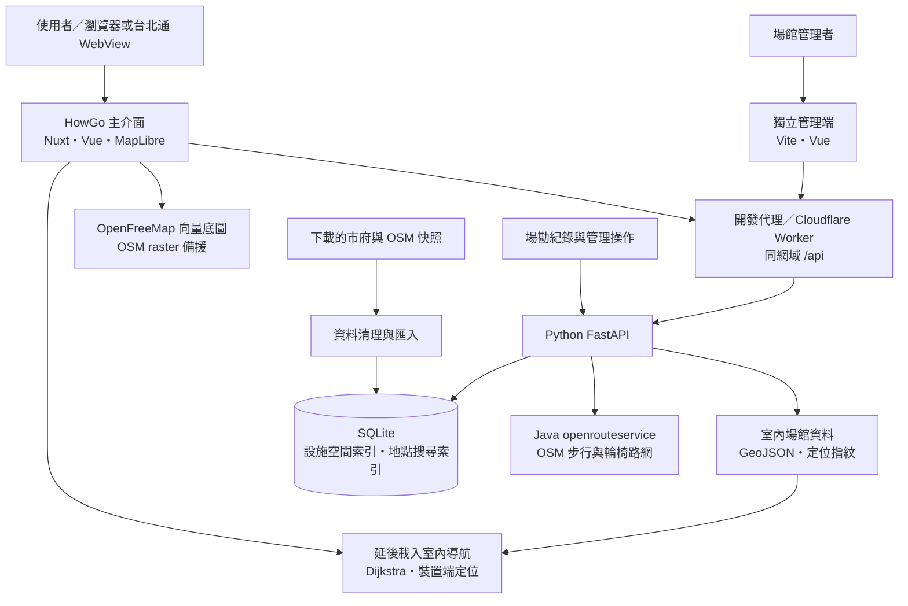

# HowGo 好行
【2026臺北秋季程式設計節-城市通微服務大黑客松】第三名得獎團隊：報報王

## **1. 專案簡介 / Project Overview**

### **專案目的與想解決的問題**

> **不只是找到目的地，而是找到真正適合自己的路線。<br>
> 整合室內外通行圖資、室內建圖與跨樓層導航，降低移動及資訊取得的門檻。**

**好行 HowGo** 是以通用與包容設計為目標的導航服務。對行動能力受限的使用者而言，最短的路線，不一定是能夠通行的路線；走到建築物門口，也不代表已經抵達真正的目的地。

我們關注的使用者包含輪椅使用者、高齡者、孕婦、暫時受傷的人、推嬰兒車或攜帶大型行李的旅客，以及面對語言障礙、資訊使用障礙的使用者。這些需求可能是長期、暫時或因情境而產生，每個人都可能需要更適合自己的導航資訊。

本專案聚焦兩個問題。

- **找到適合自身條件的路線** 整合人行道、騎樓、坡道、行人穿越道及設施資訊，提供最短距離、平衡與無障礙三種室外路線，讓使用者理解差異後選擇。
- **降低室內建圖與導航的導入門檻** 提供平面圖與 POI 建置、Wi-Fi／地磁建圖及定位驗證工具，讓導航服務能從室外入口延伸到館內目的地。

目前以 **臺北市立大學天母體育館 1F、2F** 為室內示範場域，串連「尋找附近無障礙停車格 → 室外導航至場館 → 進入室內地圖 → 跨樓層前往觀眾席」的使用流程。室內外目前各自計算路線，使用者抵達場館後切換至室內導航。

| 目標使用者 | 主要需求 | 可參考的路線條件 |
| --- | --- | --- |
| 輪椅使用者 | 避免階梯、陡坡與狹窄通道 | 無階梯、較平緩、通道較寬，跨樓層使用電梯 |
| 長者 | 減少體力負擔及跌倒風險 | 較平緩、減少繞行，跨樓層優先考慮電梯 |
| 孕婦 | 避免過度費力與長距離繞行 | 較平緩、路線較短，跨樓層優先考慮電梯 |
| 推行李箱或嬰兒車的使用者 | 減少搬運與不平整路面的影響 | 無階梯、平順通道；可自行評估是否接受短階梯換取較少繞行 |
| 暫時腳受傷者 | 降低上下樓梯與長距離步行負擔 | 無階梯、減少繞行，跨樓層優先考慮電梯 |
| 語言障礙使用者 | 理解搜尋、設施及導航操作 | 繁體中文／英文介面與清楚的導航提示 |
| 資訊使用弱勢使用者 | 理解搜尋、設施及導航操作 | 簡化版功能與使用者介面 |


### **核心功能摘要**

**🗺️ 三種室外路線比較**

同一起終點可比較三種模式的預估時間、距離與路線摘要。後端透過 openrouteservice（ORS）取得候選，再比對本機人行道、階梯與坡度資料，進行篩選及排序。不同模式可能選中同一條路線。

- **最短距離** 使用一般步行路網，從候選中選擇 ORS 預估時間最少的結果。介面名稱沿用「最短距離」，目前實際以時間排序。
- **平衡** 排除已知過窄通道及較陡坡段，接受有限的短階梯，並考量人行道覆蓋與繞路成本。
- **無障礙** 使用輪椅路由，避開階梯，另以本機資料排除已知過窄通道與實際比對到的坡段。

**📍 地點搜尋與導航**

起點、終點支援 **目前位置、地圖選點及本機地點／地址搜尋**。搜尋資料來自預先整理的 OSM 快照，以 SQLite 搜尋索引查詢。開始導航後，依位置進度呈現直行、轉彎及有資料支持的穿越道、側別與設施提示，並以地圖高亮呈現選取路段及相關設施。

**♿ 通行設施圖層**

依地圖視窗載入斜坡道、人行道、標線型人行道、行穿線、整平騎樓、無障礙電梯、廁所、友善店家、公園、停車與大眾運輸站點等圖資。設施可點選查看資訊；身心障礙停車格也可設為路線起點或終點。

**🏟️ 室內地圖與跨樓層導航**

天母體育館室內地圖呈現不同樓層的平面配置，以及電梯、樓梯、無障礙廁所、出入口等 POI（Point of Interest，興趣點）。使用者可瀏覽設施或選擇目的地，例如「二樓藍區第一排」；無障礙跨樓層路線使用電梯。導航過程依定位進度更新距離與轉向指令。

**🧭 Wi-Fi 與地磁混合定位**

在缺少 GPS 的室內環境，利用可取得的 Wi-Fi 指紋、地磁特徵與計步資訊，搭配預先建立的場域特徵地圖推估位置，並融合氣壓計等資料判斷樓層變化。主要利用手機既有感測器與場域訊號，減少大量增設專用定位硬體的需求；實際可用能力取決於裝置、平台權限及場勘品質。

**🛠️ 室內建圖與定位驗證**

管理端提供三項主要工作流程，支援未來擴展到其他公共場域。

- **樓層平面圖與 POI 建置**：上傳及校準樓層平面圖，新增、編輯電梯、樓梯、廁所及出入口等設施。
- **Wi-Fi 與地磁建圖**：使用手機蒐集場勘訊號，匯入紀錄並建立室內定位特徵地圖。
- **定位效果驗證**：記錄及回放定位結果，比較估計位置與參考位置，評估場域中的定位表現。


**🌐 友善模式與雙語介面**

一般模式以地圖探索及路線比較為主；**友善模式** 著重高對比、大字體、較大的導航指示與簡化流程，降低高齡者、視覺辨識較弱或不熟悉智慧型手機者的操作門檻。此處的友善模式對應現有程式中的無障礙介面模式，與「無障礙路線」的算路條件分別處理。

主介面與室內導航主要介面支援繁體中文、英文及語言偏好保存；來源地名、地址及部分管理介面仍保留中文。

## **2. 系統架構 / System Architecture**

### **架構圖**



室外由 **FastAPI 統一查詢資料、呼叫 ORS 並評估候選路線**。ORS 是獨立的 Java 路由服務，Python 後端透過 HTTP 與它溝通。室內則在前端以場館路網獨立算路，FastAPI 負責提供圖資與管理功能。

室外底圖採 OpenFreeMap 向量圖磚，MapLibre GL JS 負責繪製。一般模式使用調整過的 Positron，友善模式（現有無障礙介面）使用放大標籤的 Liberty；向量底圖初始化失敗時使用 OSM raster 備援。底圖、設施圖層及路由服務分別負責不同工作。

專案主要目錄如下。

```text
HowGo/
├── frontend/                  # Nuxt 主介面，載入室內導航元件
├── backend/
│   ├── rollx/                 # FastAPI、資料匯入、搜尋與路線評估
│   └── data/                  # 本機快照與產生的 SQLite
├── indoor/
│   ├── indoor-nav/            # 室內導航原始碼、管理端與測試
│   └── mapdata/               # 場館圖資、場勘資料及建圖工具
├── deploy/cloudflare/         # 主介面與管理端的 Worker 設定
└── .ors/                      # 本機 ORS、Java 與路網，未納入 Git
```

### **使用到的主要技術堆疊（Tech Stack）**

| 類別 | 技術／版本 | 說明 |
| --- | --- | --- |
| 主前端 | Nuxt 4、Vue 3、TypeScript | 以客戶端模式執行，提供地圖、搜尋、路線比較及導航介面 |
| 室外地圖 | MapLibre GL JS 5、OpenFreeMap、OSM | 向量底圖、GeoJSON 圖層與路線繪製 |
| 室內前端／管理端 | Vue 3、Vite、MapLibre GL JS 6 | 場館地圖、樓層操作、管理及場勘介面 |
| 後端 API | Python、FastAPI、Uvicorn、HTTPX | 本機資料服務、ORS 呼叫與候選評估 |
| 空間運算 | Shapely | 路線與人行道、坡段等圖資的幾何比對 |
| 資料儲存與搜尋 | SQLite、R*Tree、FTS5、雙字索引 | 設施視窗查詢、中文地點與地址搜尋 |
| 室外路由 | openrouteservice 9.10.0、Java 21 | 使用 OSM 建置一般步行與輪椅路網 |
| 室內算路 | TypeScript、Dijkstra | 依場館路網及通行限制規劃路線 |
| 室內定位 | 計步／PDR、地磁、Wi-Fi 指紋、粒子濾波、氣壓計 | 依裝置可用感測資料融合定位及樓層判斷 |
| 資料處理 | NumPy、Pillow、GeoJSON、JSON／gzip | 場館建圖、資料清理與固定快照 |
| 套件與環境 | 主前端 pnpm 10、室內套件 npm、Python venv | 各套件依鎖檔及 requirements 安裝 |

## **3. 安裝與執行方式 / Installation & Run**

### **本地端執行方式**

以下以 macOS／Linux 為例。建議準備 **Node.js 24 LTS、pnpm 10、Python 3.11 以上、Java 21**，並確認 Python 所使用的 SQLite 支援 FTS5 與 R*Tree。主前端使用 pnpm；室內子專案依既有 npm 鎖檔使用 npm。Python 使用 venv。

**1. 取得專案**

```sh
git clone https://github.com/taipei-doit/townpass2026-HowGo
```

後續每個小節都從 HowGo 根目錄開始。長時間運行的服務請各開一個終端機。

**2. 安裝室內元件與管理端依賴**

```sh
cd indoor/indoor-nav
npm ci
```

**3. 建立 Python 環境、匯入快照並啟動 API**

```sh
cd backend
python3 -m venv .venv
source .venv/bin/activate
python -m pip install -r requirements.txt
python -m rollx.import_facilities
python -m rollx.places
python -m uvicorn rollx.main:app --reload --port 8000
```

匯入指令使用 `backend/data/source/` 的本機資料快照。已建立相容資料庫時可略過重建。地點搜尋若出現 `PLACES_UNAVAILABLE` 或舊版索引不相容，可在 backend 的 venv 重新執行 `python -m rollx.places`，建立新版搜尋資料庫。


**4. 準備並啟動 ORS**

`.ors/` 未納入 Git，需要另行準備 ORS 9.10.0 JAR、Java 21，以及涵蓋服務範圍的 OSM PBF。先建立 `.ors/ors-config.yml`，並將檔案路徑對應到實際資料。

```yaml
ors:
  engine:
    profile_default:
      graph_path: ./graphs
      build:
        source_file: ./taipei.osm.pbf
        elevation: false
    profiles:
      driving-car:
        enabled: false
      foot-walking:
        enabled: true
      wheelchair:
        enabled: true
```

```sh
cd .ors
java -Xmx2g -jar ors.jar --server.address=127.0.0.1 --server.port=8080
```


也可透過 `ORS_BASE_URL` 指向已啟用兩種 profile 的 ORS。室內路徑規劃不依賴 ORS。完整設定可參考 [ORS 自架文件](https://giscience.github.io/openrouteservice/run-instance/)。

**5. 啟動 HowGo 主介面**

```sh
cd frontend
pnpm install --frozen-lockfile
pnpm dev
```

**6. 啟動場館管理端（需要管理／建圖時）**

```sh
cd indoor/indoor-nav
npm run dev
```

### **需要設定的環境參數（.env example）**

主前端可在 `frontend/.env` 設定下列參數。

```dotenv
ROLLX_API_TARGET=http://127.0.0.1:8000
NUXT_PUBLIC_TILE_URL=https://tile.openstreetmap.org/{z}/{x}/{y}.png
```

後端使用程序環境變數，以下以終端機設定為例，設定後再啟動 Uvicorn。

```sh
export ORS_BASE_URL='http://127.0.0.1:8080/ors'
```

管理端如需改用其他後端位址，在啟動 Vite 的終端機設定。

```sh
export HOWGO_API_TARGET='http://127.0.0.1:8000'
```

| 參數 | 說明 |
| --- | --- |
| `ROLLX_API_TARGET` | Nuxt 開發代理的 FastAPI 位址 |
| `NUXT_PUBLIC_TILE_URL` | 向量底圖初始化失敗時的 raster 備援圖磚 |
| `ORS_BASE_URL` | 後端連線的 ORS 根路徑，預設包含 `/ors` |
| `ORS_API_KEY` | 視 ORS 服務需求設定，僅供後端使用 |
| `ROLLX_DB_PATH` | 設施 SQLite 路徑；地點搜尋資料庫另行建立 |
| `HOWGO_INDOOR_MAPDATA` | 室內場館資料根目錄 |
| `HOWGO_INDOOR_PYTHON` | 管理建圖工作使用的 Python 執行檔 |
| `HOWGO_API_TARGET` | Vite 管理端開發代理的 FastAPI 位址 |

後端參數請以環境變數注入，單獨建立 `.env` 檔不代表會自動讀取。瀏覽器定位需要使用者授權及安全來源，手機區網 HTTP 測試可能無法定位，請使用 HTTPS 或支援定位橋接的台北通 WebView。室內即時感測定位需原生橋接；iOS 的 Wi-Fi 掃描能力受限，需要搭配已知／手動起點及可用感測器。

## **4. 功能說明 / Features**

| 功能編號 | 功能名稱 | 功能說明 | 使用資料／技術 |
| --- | --- | --- | --- |
| F01 | 地圖探索與圖層篩選 | 以地圖為主，依需求顯示設施及通行空間，點選查看資料 | MapLibre、OpenFreeMap、市府快照 |
| F02 | 起終點設定 | 支援目前位置、地圖選點、本機地點與地址搜尋 | 瀏覽器／原生定位橋接、SQLite FTS5 |
| F03 | 三種路線比較 | 比較最短距離、平衡與無障礙路線的時間及距離 | ORS、FastAPI、本機通行資料 |
| F04 | 室外導航 | 顯示直行、轉彎及有資料依據的穿越道、側別和設施指引 | ORS 幾何、指令整併、空間比對 |
| F05 | 路線與設施高亮 | 依選取路段區分路線、人行道面及相關坡道等設施 | GeoJSON、MapLibre 圖層 |
| F06 | 身障停車格查詢 | 顯示身心障礙專用格位，可設為起點或終點 | 臺北市路邊停車格位快照 |
| F07 | 室內地點與跨樓層導航 | 瀏覽館內設施、前往二樓藍區等目的地，無障礙跨層使用電梯 | 團隊場館圖資、Dijkstra |
| F08 | 室內感測定位 | 融合可用的計步、地磁、Wi-Fi 與氣壓資料，更新進度 | 裝置端定位、台北通感測橋接 |
| F09 | 場館管理及定位驗證 | 平面圖與 POI 建置、Wi-Fi／地磁建圖、定位效果驗證 | Vite 管理端、FastAPI、Python 工具 |
| F10 | 友善模式與雙語 | 高對比、大字體及簡化流程；主要使用者介面支援中英文 | Vue 語系機制、語言偏好保存 |

圖上的人行道以紅色、黃色及藍綠色，分別呈現不可行、勉強可行及可行的通行分級，協助使用者快速辨識差異。**目前分級由 HowGo 依來源寬度門檻推估，不等同市府對所有使用者的通行認證**；具體門檻與缺值處理如下。

### **三種路線如何選擇**

ORS 負責依 OSM 路網產生候選；**市府資料的後置篩選與評分由 HowGo 的 FastAPI 負責**。ORS 不會自動理解專案本機資料庫中的所有設施與通行分級。

| 模式 | ORS 候選來源 | HowGo 的限制與選擇方式 |
| --- | --- | --- |
| 最短距離 `fastest` | `foot-walking`，比較 `fastest` 與補充的 `shortest` 候選 | 可經階梯及坡段，以 ORS 預估秒數排序 |
| 平衡 `balanced` | `foot-walking` 的 `recommended` 替代候選，再補 `shortest` | 排除過窄人行道、已知坡度達 8% 或 `steep` 坡段；最多接受一段總長不超過 8 公尺的階梯，缺少階梯資料的候選淘汰；通過後依繞路、人行道、階梯與坡段評分 |
| 無障礙 `accessible` | `wheelchair` 的 `recommended` 替代候選 | ORS 設定避開階梯、最大坡度 4%、最小寬度 0.9 公尺；後端另排除已知階梯、過窄人行道及與路線實際比對到的已知坡段 |

「一段 8 公尺以內的階梯」是目前用來近似少量階梯的專案門檻，並非已確認的一層樓。人行道依來源寬度分為 **可行（≥ 1.5 公尺）、勉強可行（≥ 0.9 且 < 1.5 公尺）、不可行（< 0.9 公尺）**，缺少寬度或未比對到則為待確認。這項分級未包含臨時障礙或現場有效淨寬。

目前的候選評分如下，分數越低越優先，同分時比較 ORS 預估時間。

| 模式 | 評分公式 |
| --- | --- |
| 最短距離 | `ORS 預估秒數` |
| 平衡 | `d / d_min − 0.22 × G − 0.10 × F + 0.015 × S + 0.04 × I` |
| 無障礙（目前網頁預設） | `d − 0.55 × G − 0.20 × F` |

`d` 為候選距離（公尺），`d_min` 為該輪候選最短距離，`G`、`F` 分別為可行、勉強可行的人行道覆蓋比例（0～1），`S` 為階梯總長（公尺），`I` 為比對到的已知坡段筆數。舊 API 仍保留可選的 `preferences` 評分分支，網頁目前直接使用三種模式。

**目前無障礙模式通過限制後，排序仍以距離為主。** 覆蓋比例最多折抵 0.55 分，其影響不到 1 公尺的距離分數，因此尚不能宣稱會積極繞行以取得更多人行道覆蓋。

平衡模式若因階梯限制找不到合格候選，會再嘗試全面避開階梯。平衡與無障礙仍無合格結果時，後端會將被淘汰候選比對到的障礙轉成避讓多邊形，累積條件後最多重算兩輪。有合格候選時直接排序選擇，尚未持續搜尋所有可能的更佳繞路。個別模式失敗不影響其他可用模式。

原始選點先在 50 公尺內尋找路網接點，失敗端點可擴大到 120 公尺重試；偏移超過 50 公尺會另行標示。**時間與距離以路網接點間的結果計算，原選點到接點的接近路程未計入，也不代表兩者之間已有可通行路徑。**

### **使用資料集與來源**

本服務整合市府設施資料、OSM 路網與搜尋資料，以及團隊建置的室內場館資料，涵蓋超過 10 種通行相關圖資。下表列出 7 項資料來源及另行使用的底圖服務；其中室內場館圖資為團隊建置，未將它直接列為政府開放資料集。

| 資料集／來源 | 提供者 | 使用方式 |
| --- | --- | --- |
| [輪行臺北設施資料](https://data.taipei/dataset/detail?id=2b58f15a-dec6-4b9d-91be-4eaccfda5ae7) | 臺北市政府交通局 | 斜坡道、無障礙電梯、公園、出入口、店家、廁所、人行道、標線型人行道、行穿線、身障設施、停車與站點等圖層及坡度紀錄 |
| [臺北捷運車站出入口無障礙電梯、無障礙坡道 GPS 座標](https://data.taipei/dataset/detail?id=0a3bb422-9eb5-459b-a9d4-138456516183) | 臺北大眾捷運股份有限公司 | 補充捷運出入口電梯及坡道，與設施快照合併 |
| [臺北市公廁點位資訊](https://data.taipei/dataset/detail?id=ca205b54-a06f-4d84-894c-d6ab5079ce79) | 臺北市政府環保局 | 將無障礙廁座數大於 0 的點位匯入無障礙廁所圖層 |
| [臺北市騎樓整平工程完成路段表](https://data.taipei/dataset/detail?id=09504c47-7349-4cab-9ce6-db30f32a392e) | 臺北市都發局建管處 | 民國 91～105 年完工路段，用於整平騎樓圖層及側別指引 |
| [臺北市路邊停車格位](https://data.taipei/dataset/detail?id=5a911ea5-1694-4301-808e-e1780d971611) | 臺北市交通局停管處 | 篩選身心障礙專用格位代碼 03、04、18，提供圖層及起終點設定 |
| [OpenStreetMap 臺灣資料／Geofabrik](https://download.geofabrik.de/asia/taiwan.html) | OSM 貢獻者；Geofabrik 提供下載 | ORS 路網、本機地點與地址搜尋、穿越道及 `incline` 坡度快照 |
| 天母體育館場館圖資 | 團隊依北市大公告工程平面圖、體育館現場照片製作 | 室內樓層、牆面、POI、路網及定位指紋，存放於 `indoor/mapdata/data/tianmu/` |
| [OpenFreeMap](https://openfreemap.org/) | OpenFreeMap 與相關開放圖資專案 | 線上向量底圖；與本機設施快照及路由資料分開管理 |

輪行臺北涵蓋的設施類型包括 **1 斜坡道、3 路外停車場無障礙電梯、4 公園、7 捷運站出入口及公園無障礙出入口、8 友善店家、9 無障礙廁所、11 人行道、12 標線型人行道、13 行穿線、14 身障設施、15 路邊停車場、16 路邊停車格、18 公車站及 20 捷運站**。類型存在不代表每個下載版本都有完整點位；無障礙廁所另以公廁資料補充。站點圖層供查詢使用，目前尚未提供大眾運輸算路。

## **5. 致謝 / Acknowledgments**

感謝以上資料集來源，以及 OpenStreetMap 貢獻者，讓通行環境與設施資訊得以整合。

本專案亦使用下列開放原始碼及開放圖資工具。

- [Nuxt](https://nuxt.com/)、[Vue](https://vuejs.org/)、[Vite](https://vite.dev/) 與 [TypeScript](https://www.typescriptlang.org/)，提供前端開發基礎。
- [MapLibre GL JS](https://github.com/maplibre/maplibre-gl-js)、[OpenFreeMap](https://openfreemap.org/) 與 [OpenMapTiles](https://openmaptiles.org/)，提供地圖呈現及底圖相關技術。
- [openrouteservice](https://github.com/GIScience/openrouteservice)，提供一般步行及輪椅路網計算。
- [FastAPI](https://fastapi.tiangolo.com/)、[Uvicorn](https://www.uvicorn.org/)、[HTTPX](https://www.python-httpx.org/)、[Shapely](https://shapely.readthedocs.io/) 與 [SQLite](https://www.sqlite.org/)，提供 API、空間計算及本機資料儲存。
- [NumPy](https://numpy.org/)、[Pillow](https://python-pillow.github.io/)、[Vitest](https://vitest.dev/) 及其他依賴工具，支援資料處理、室內建圖與驗證。

OSM 資料依 [ODbL 1.0](https://opendatacommons.org/licenses/odbl/1-0/) 使用，地圖需保留 [OSM 署名](https://www.openstreetmap.org/copyright) 及底圖要求的署名。使用 OSM 公共 raster 圖磚時，亦須遵守其 [圖磚使用政策](https://operations.osmfoundation.org/policies/tiles/)。各程式套件、政府資料及場館原始平面圖的授權分別適用，開源套件授權與資料授權應分開檢視。競賽符合性仍應依實際競賽文件逐項確認，本文件未將其列為已完成查證的事項。

# <br><br>**AI Usage Declaration**

## **1. AI 模型**

- ChatGPT：GPT-6.1 Astra / Sol
- Claude：Claude Opus 5.5

## **2. 使用範圍**

### **程式碼產生**

### **文字生成**

AI 協助整理開發規格、技術說明、README、介面文案與英文語系文字。道路、地址及設施名稱以資料來源為準，英文介面仍可能保留中文來源名稱。

## **3. AI 產生內容如何被驗證或修改**

本文件以現有專案 README、套件設定、前端整合設定與功能資料整理，並將限制及待確認項目分開說明。程式與文案可透過下列方式持續驗證。

- **程式檢查** 執行前端型別檢查、建置、室內測試及後端測試。
- **路線比對** 使用相同起終點比較三種模式，檢查候選、限制、評分、地圖幾何與導航指令的一致性。
- **介面測試** 在不同螢幕寬度及中英文介面操作搜尋、路線選擇、導航與室內功能。
- **場域驗證** 比對人行道、坡段、穿越道及室內設施，確認實際通行條件與定位表現。

上述項目為驗證方法；本聲明不代表每個版本都已完成全部實機與現場測試。