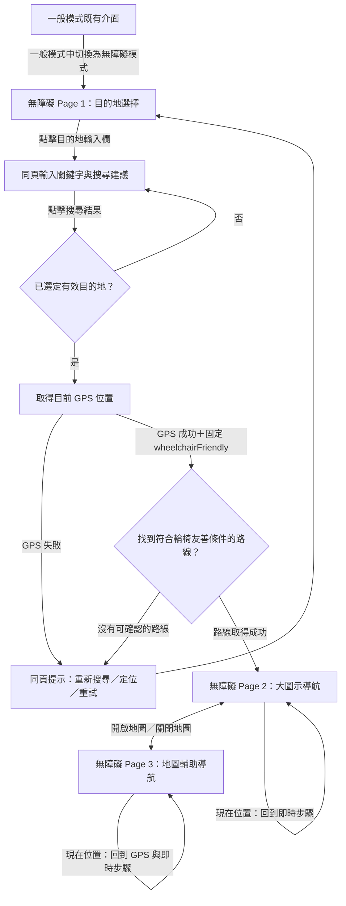

# 城市通無障礙導航｜無障礙模式三頁前端流程規格

> **給 Claude Code 的開發文件**  
> 版本：v1.0｜2026-11-08  
> 專案：台北通大黑客松｜Flutter Web（Mobile-first）  
> UI 範圍：無障礙模式三個已定稿畫面  
> 視覺依據：`accessible-mode-3pages.png`、官方 `DESIGN.md`  
> 與既有一般模式的關係：此文件**補充** `ACCESSIBLE_NAV_FLUTTER_WEB_SPEC.md`，僅定義「無障礙模式」，**不改寫一般模式既有流程**。

---

## 0. 給 Claude Code 的執行指示

請先閱讀本文件、既有一般模式實作規格、`DESIGN.md` 與無障礙模式三頁設計圖，再檢查現有 Flutter Web 程式碼。**沿用專案現有路由、地圖、GPS、狀態管理與導航資料模型**，不要另做一套互不相通的導航引擎。

開發重點：

1. 依定稿設計圖實作 **3 個畫面／狀態**，維持黑底黃字高對比視覺。
2. 讓所有可見控制項具有對應行為，不是只有靜態截圖。
3. 目的地搜尋在第一頁**原地展開結果**，不跳到一般模式的搜尋頁。
4. 無障礙模式**固定使用 `wheelchairFriendly` 路線**；不顯示最快／平衡、載具類別或進階路線偏好。
5. 大圖示導航與地圖輔助導航是**同一個導航 Session 的兩種顯示模式**，切換不得清除或重啟路線。
6. 第三頁可以**左右滑動預覽導航步驟**，但不能修改 GPS 判斷的真實導航進度。
7. 不新增截圖中不存在的常駐操作列、資訊卡、語音按鈕或「結束導航」按鈕。
8. 完成後執行 `dart format`、`flutter analyze`、相關測試與 `flutter build web`，若無法執行，說明實際原因。

### 規格優先順序

1. **本文件**：互動流程、狀態與功能。
2. **三頁定稿圖**：畫面布局、元件數量及資訊階層。
3. **`DESIGN.md`**：官方設計 token、字體與元件風格。
4. **一般模式既有實作**：可重用的服務與技術架構。

不要把 Stitch 編輯畫布的外框、畫布標題、紫色框線或裝置展示框畫進 Web App。

---

## 1. 頁面對照與命名

| UI 定稿圖 | 畫面名稱 | 建議程式識別 | 功能 |
|---|---|---|---|
| 左：Page 1 | 目的地選擇 | `AccessibleDestinationScreen` | 同頁搜尋目的地，使用 GPS 目前位置做起點 |
| 中：Page 2 | 大圖示導航 | `AccessibleLargeDirectionScreen` | 用文字＋超大方向箭頭指示下一步 |
| 右：Page 3 | 地圖輔助導航 | `AccessibleMapNavigationScreen` | 查看相同路線地圖、左右滑動預覽步驟 |

**三頁是唯一的主要畫面。** 搜尋輸入、搜尋建議、定位／路線載入中、錯誤通知可在現有畫面內以狀態呈現，勿因此擴增獨立頁面。

畫面參考檔：`design/references/accessible-mode-3pages.png`（建議路徑，請依實際專案結構調整）。

---

## 2. 全域色彩、字體與操作準則

### 2.1 官方色票（以 DESIGN.md 為準）

| 用途 | Token | HEX |
|---|---|---|
| 主背景 | Grey/950 | `#0B0D0E` |
| 卡片／底部操作列背景 | Grey/800 | `#30383D` |
| 強調文字、邊框、方向箭頭、導航線 | Secondary/500 | `#F5BA4B` |
| 次要說明文字 | Secondary/100 | `#FCF2DF` |
| 聚焦或選取強調 | Secondary/400 | `#F0C87C` |

不要把一般模式藍綠色當成此模式的主要文字或導航路線顏色。不得僅以顏色傳達功能，設施應同時有文字／圖示。

### 2.2 無障礙設計基準

- 所有可見文案：**繁體中文（臺灣用語）**。
- 沿用官方字體家族，標題／重要導航指令使用大字及粗體；按鍵文字清楚可辨。
- 重要觸控區建議最小 **48 × 48 logical pixels**；不要讓元件過小或相互重疊。
- 支援作業系統文字放大及 Flutter `textScaler`；文字換行時不能截斷重要指示。
- 每個圖示按鈕都要有可見中文名稱及適當 `Semantics(label: ...)`。
- 不依賴純色差區分路線或導航狀態；高對比亦不等同保證所有色覺障礙者都能辨識。
- 保持草圖大量留白，不要為了填滿畫面額外增加卡片、數據或說明。

---

## 3. 主要頁面流程



### 核心流程約束

- **Page 1 → Page 2**：選取有效搜尋結果後，系統自動用 GPS 與固定的輪椅友善設定取得路線；成功後直接進 Page 2，**不用讓使用者再挑路線**，也不要新增一張規劃確認頁。
- 搜尋欄只有自由文字時，**不能任意把第一個模糊匹配結果當成目的地**；須選定具體搜尋結果或取得足夠明確的地點。
- **Page 2 ↔ Page 3**：只能切換導航呈現方式；不得重新搜尋路線、重設目的地或導航進度。
- 真正是否到達下一步須由 GPS／導航邏輯決定，不得因使用者手動滑動就跳步。

---

## 4. Page 1｜目的地選擇

### 4.1 與定稿圖一致的靜態畫面

- 近黑背景 `#0B0D0E`。
- 上方大標題：**「去哪裡？」**。
- 欄位標籤：**「目的地：」**。
- 大型深灰輸入框，黃色邊框，placeholder **「請輸入目的地」**。
- 其餘區域保持空白。
- **不加**地圖、起點欄、語音按鈕、常用地點、進階設定、導航按鈕或底部分頁列。

### 4.2 點擊及輸入行為

| 事件 | 要執行的動作 | 畫面結果 |
|---|---|---|
| 點擊目的地欄 | 取得輸入焦點，啟用原生鍵盤 | 留 Page 1 |
| 輸入地點／地址 | 呼叫既有地點搜尋服務；搜尋時顯示載入狀態 | 搜尋建議直接出現在輸入框下方 |
| 清除文字 | 清空查詢與舊搜尋建議 | 留 Page 1 |
| 點擊某筆建議 | 保存目的地的名稱、地址、座標、可選 POI ID | 留在 Page 1 等待定位／路線查詢 |
| 定位與路線成功 | 起點＝裝置 GPS；路線＝`wheelchairFriendly`；建立導航 Session | 進 Page 2 |
| 搜尋、定位或路線失敗 | 顯示大字且可理解的錯誤訊息及重試入口 | 留 Page 1，不假裝已導航 |

### 4.3 進入 Page 2 的前置條件

- 已明確取得目的地 `name + latitude + longitude`。
- 已取得有效起點；預設裝置目前位置。
- 已選定輪椅友善路線並取得可用路線幾何與導航步驟。

**路線可通行性的實作底線：** 不能僅憑路線名稱或 Mock 預設就聲稱「已驗證全程無障礙」。已知階梯、不可通行段不得包裝成輪椅友善；資料不足時呈現「無法確認可通行」等訊息，不可默默改用最快路線。

---

## 5. Page 2｜大圖示導航

### 5.1 與定稿圖一致的畫面

- 頂端深灰黃框目的地欄：**「目的地：天母體育館」**。
- 大型文字：**「前進 300 公尺後左轉」**。
- 中央極大的黃色**左轉箭頭**；沒有圓形背景、地圖或其他資訊卡。
- 底部深灰操作列，黃色上框線／中間直線，兩個等寬按鈕：
  - 左：定位圖示＋**「現在位置」**
  - 右：地圖圖示＋**「開啟地圖」**
- **不加**路線統計、ETA、GPS 狀態卡、語音開關、路線比較、「結束導航」按鈕。

### 5.2 按鈕與更新行為

| 元件 | 點擊後 | 導頁 |
|---|---|---|
| 現在位置 | 將顯示中的指令恢復為 GPS 對應的**目前導航步驟**；可顯示短暫文字提示「已回到目前導航進度」；不需顯示地圖 | 留 Page 2 |
| 開啟地圖 | 把同一個導航 Session 的呈現方式切到地圖輔助模式 | **Page 3** |
| 目前步驟更新（系統事件） | 更新主要文字與大型箭頭；保持文字、距離、方向一致 | 留 Page 2 |

### 5.3 導航指令同步

畫面示例「前進 300 公尺後左轉」表示**還要先前進，再於指定轉向點左轉**；不要把顯示的大左轉箭頭當作「現在立刻左轉」的導航判定。實作時以同一個 `NavigationStep` 的動作、剩餘距離和描述推導文字與圖示，避免兩者互相矛盾。

---

## 6. Page 3｜地圖輔助導航

### 6.1 與定稿圖一致的畫面

- 延續黑／深灰底與黃字黃線。
- 頂部目的地欄與 Page 2 一致。
- 中間大面積**深色導航地圖**，顯示：目前位置、已選定的輪椅友善路線、目的地及少量必要的無障礙設施標示。
- 地圖下方一張**精簡導航指令卡**：方向圖示、指令「前進 300 公尺後左轉」、一行必要的道路描述、步驟指示點、文字＋手勢提示 **「左右滑動切換步驟」**。
- 最底部採用**與 Page 2 完全相同尺寸、佈局、線框的雙欄操作列**：
  - 左：定位圖示＋**「現在位置」**
  - 右：地圖圖示＋**「關閉地圖」**
- 不新增指南針、語音、結束導航等定稿圖未出現的常駐按鈕。

### 6.2 地圖互動

- 使用者可平移、縮放地圖；不要因操作地圖就更換導航步驟。
- 地圖預設聚焦使用者目前 GPS 附近的路線；必要地理標籤需清楚。
- 「現在位置」可一鍵回復地圖中心與即時導航步驟。
- 地圖線使用 Polyline，不能用巨大不規則黑色遮罩或跨建築物的直線取代實際路徑。
- 對未完成導航的路段保持清楚高亮；其他地圖內容降低視覺權重。

### 6.3 指令卡左右滑動（重要）

| 互動 | 行為 |
|---|---|
| 在**指令卡**向左滑 | 預覽下一個導航步驟（若存在） |
| 在**指令卡**向右滑 | 預覽上一個導航步驟（若存在） |
| 切換預覽步驟 | 更新指令文案、方向圖示、步驟 dots 的作用中位置；必要時將地圖視角移到對應路段 |
| 滑到第一步／最後一步 | 停在邊界，不循環跳到另一端 |
| 點「現在位置」 | 清除預覽狀態、恢復目前 GPS 的步驟、地圖重新定位 |
| 點「關閉地圖」 | 進 Page 2，**保留同一導航 Session** |

**區分兩種 Index：**

- `currentStepIndex`：導航引擎根據 GPS／路徑進度判定的**真實步驟**。
- `previewStepIndex`：使用者為了查看前後步驟而暫時預覽的步驟。

畫面顯示步驟的規則：`displayStepIndex = previewStepIndex ?? currentStepIndex`。  
滑動只改 `previewStepIndex`，**不得修改** `currentStepIndex` 或 GPS 位置。

### 6.4 步驟指示點與手勢提示

- 使用截圖中簡潔 dots 樣式，**至少要有作用中／非作用中差異**；不要靠顏色差異作為唯一線索，作用中可較長或較大。
- 示意圖可顯示 4 個步驟、目前預覽第 2 步；實際 dots 數量由 `navigationSteps.length` 決定，避免固定寫死。
- 提示短句為 **「左右滑動切換步驟」**，搭配手勢圖示；只有在指令卡可滑動時顯示。
- 目前定稿圖沒有「上一步／下一步」的額外常駐按鈕，**先不新增**。

### 6.5 切換到 Page 2 時

點「關閉地圖」只切換 `navigationDisplay = largeArrow`；保留路線、目的地、真實步驟、語音或其他背景導航服務（若已有）。建議清除純視覺預覽 `previewStepIndex`，回到 Page 2 時顯示即時步驟；再次開圖時可重新預覽。

---

## 7. 全部可點擊元件與導頁總表

| 所在頁 | 元件 | 事件／狀態更新 | 前往 |
|---|---|---|---|
| Page 1 | 目的地輸入框 | Focus／輸入文字 | Page 1 |
| Page 1 | 搜尋建議項目 | 設定 destination，取得 GPS，查詢 wheelchair-friendly 路線 | 成功進 Page 2；失敗留 Page 1 |
| Page 2 | 現在位置 | 恢復即時導航指令（無地圖） | Page 2 |
| Page 2 | 開啟地圖 | `navigationDisplay = map` | Page 3 |
| Page 3 | 地圖拖曳／縮放 | 只改地圖 camera | Page 3 |
| Page 3 | 指令卡左／右滑 | 更新 `previewStepIndex` 與顯示步驟 | Page 3 |
| Page 3 | 現在位置 | 清除預覽，地圖跟隨 GPS | Page 3 |
| Page 3 | 關閉地圖 | `navigationDisplay = largeArrow` | Page 2 |

---

## 8. 狀態管理與資料模型（Dart 示意）

使用現有專案的 Riverpod、Provider、Bloc 或其他單一架構；勿為無障礙模式另起一套矛盾的全域狀態。

```dart
enum InterfaceMode { general, accessible }
enum AccessibleView { destination, largeArrow, mapAssisted }
enum NavigationDisplay { largeArrow, mapAssisted }
enum RouteKind { fastest, balanced, wheelchairFriendly }

class Destination {
  final String name;
  final String? address;
  final double latitude;
  final double longitude;
  final String? poiId;
  const Destination({
    required this.name,
    required this.latitude,
    required this.longitude,
    this.address,
    this.poiId,
  });
}

class AccessibleNavigationUiState {
  final AccessibleView view;
  final String searchQuery;
  final Destination? destination;
  final bool searching;
  final bool routeLoading;
  final String? errorMessage;
  final NavigationDisplay display;
  final int currentStepIndex;
  final int? previewStepIndex;

  // 路線、導航步驟與 GPS 位置請沿用既有 NavigationSession / Map models。
  // 無障礙模式的 routeKind 固定為 RouteKind.wheelchairFriendly。
}
```

**共享導航 Session 至少應包含：** `origin`（GPS 座標）、`destination`、`selectedRoute`（含 geometry）、`navigationSteps`、`currentStepIndex`、`currentPosition`、`navigationStatus`。  
**UI 專屬狀態**才包含 `AccessibleView`、`searchQuery`、`previewStepIndex`、地圖 camera。

### 切換模式的整合原則

- 從一般模式選「無障礙模式」後，進入無障礙 Page 1；不要在無障礙三張頁面自行多加切換按鈕。
- **輪椅友善固定為不可變的路線條件**，不能用一般模式的最快／平衡路線直接冒充無障礙模式。
- 若未來支援**導航途中**從一般模式切到無障礙模式，而目前並非 wheelchair-friendly 路線，必須先重新取得符合條件的路線；不可靜默沿用原路線。
- 畫面 2/3 是同一導航狀態的視覺切換，不能建立新的 Session。

---

## 9. Demo Data、定位與真實服務界線

- 有既有地圖／GPS／路線 API：優先重用，不要因為新增無障礙模式退回靜態畫面。
- 尚無後端：使用**可重現、可切換的 Mock 路線與導航步驟**，可以展示「天母體育館」、「前進 300 公尺後左轉」及四個導航步驟。
- Mock 路線必須明確標記為 **Demo／示意**，不能宣稱官方驗證通行；不能以虛構 GPS 顯示成真的定位成功。
- 不可以把示意用的「全程無階梯」作為沒有證據的真實道路安全保證。
- 地圖可用現有 OSM/Flutter 地圖元件；Screenshot 只能作為**樣式參考**，不能假裝圖片內所有地點與線段都可真實點擊。
- 當 GPS 權限遭拒、搜尋失敗、無路線或網路錯誤時，留在當前畫面並提供大字說明和可操作的重試，不要跳入假導航狀態。

### 預設 Mock（僅用於前端展示）

```yaml
destination: 天母體育館
routeKind: wheelchairFriendly
navigationSteps:
  - 前進 300 公尺後左轉
  - 沿無障礙人行道前進
  - 經過坡道，繼續直走
  - 抵達天母體育館入口
initialCurrentStepIndex: 0
```

---

## 10. 建議元件架構（不強迫重構既有專案）

```text
lib/
  features/
    accessible_mode/
      screens/
        accessible_destination_screen.dart
        accessible_large_direction_screen.dart
        accessible_map_navigation_screen.dart
      widgets/
        accessible_destination_field.dart
        large_direction_instruction.dart
        accessible_bottom_action_bar.dart
        swipeable_step_instruction.dart
      state/
        accessible_mode_controller.dart  # 或重用現有控制器
      theme/
        accessible_theme_tokens.dart
```

**必須重用／共用：** 地點搜尋服務、GPS、路線查詢、地圖套件、Navigation Session 與導航步驟模型。  
**適合抽成共用元件：** Page 2／Page 3 完全相同的底部雙欄操作列、頂部目的地欄。

---

## 11. 驗收條件（Definition of Done）

- [ ] 已完成三頁畫面，視覺佈局與定稿圖一致。
- [ ] 使用 `DESIGN.md` 官方黑、黃、深灰色票，文字及操作元件有清楚對比。
- [ ] Page 1 只顯示「去哪裡？」及目的地輸入欄作為初始狀態。
- [ ] Page 1 可在**同頁**搜尋並點選具體目的地。
- [ ] 選目的地後，自動使用 GPS 起點，查詢 `wheelchairFriendly` 路線；成功進 Page 2。
- [ ] 無障礙模式不出現最快／平衡／進階偏好選項。
- [ ] Page 2 大字導航文字與方向箭頭會依真實／Mock 步驟同步更新。
- [ ] Page 2 最底部**只有**「現在位置」「開啟地圖」兩個等寬控制項。
- [ ] Page 2 點開啟地圖進 Page 3，目的地、路線、真實進度不重設。
- [ ] Page 3 地圖有目前位置、同一路線、必要設施標記。
- [ ] Page 3 下方導航卡可左右滑動，dots 與目前預覽步驟同步。
- [ ] Page 3 滑動預覽不修改 `currentStepIndex`。
- [ ] Page 3「現在位置」恢復 GPS 位置及即時步驟。
- [ ] Page 3「關閉地圖」回 Page 2；重新開啟地圖不會開始新導航。
- [ ] Page 2/3 底部操作列尺寸、樣式、圖文排列一致。
- [ ] 沒有額外新增定稿圖以外的常駐「結束導航」、指南針、語音開關、ETA 卡片。
- [ ] 支援放大文字、語意標籤、可理解的錯誤提示。
- [ ] 已運行 Flutter 靜態分析、格式化與測試（或回報限制）。

### 建議測試案例

1. 從一般模式切到無障礙模式 → Page 1 → 搜尋「天母體育館」→ 選結果 → Page 2。
2. Page 2 點「開啟地圖」→ Page 3；點「關閉地圖」→ Page 2，確認同一 Session。
3. Page 3 左滑到第 2 步，再右滑回第 1 步；確認 GPS 真實進度不受影響。
4. Page 3 預覽第 3 步後，點「現在位置」→ 顯示實際當前步驟，地圖回到 GPS。
5. GPS 權限被拒或路線查詢失敗 → 不進 Page 2，顯示清楚錯誤與重試方式。
6. 將文字放大，確認「目的地：天母體育館」、「前進 300 公尺後左轉」與底部按鈕不溢出。

---

## 12. 完成後回報格式

請 Claude Code 最後回報：

1. **完成的畫面及互動**：逐頁列出實際可操作功能。
2. **改動檔案**：新增與修改的路徑。
3. **狀態／服務共用方式**：如何與既有一般模式整合。
4. **Mock 與真實功能差異**：地點搜尋、GPS、路線計算、導航步驟各自狀態。
5. **測試結果**：`flutter analyze`、測試與 Web build。
6. **已知限制及下一步**：不宣稱未完成的功能已完成。

> 本文件的目標：**在不增加更多頁面的前提下，完成「選目的地 → 大圖示導航 ↔ 地圖輔助導航」的三頁無障礙模式完整可操作流程。**
