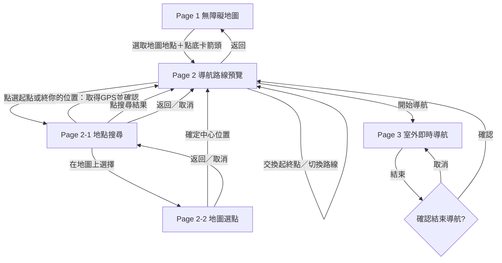

# 城市通｜無障礙導航 Flutter Web 前端實作規格（Claude Code 專用）

> 文件版本：v1.0（2026-11-07）  
> 開發階段：第一輪可操作的前端 Demo  
> 語言：繁體中文（臺灣用語）  
> 技術目標：Flutter Web（Mobile-first）  
> 規格來源：已確認的五張 Stitch UI 圖、各頁草圖與本次對話已定案的互動行為  
> **本文件是實作需求，不代表現有系統已串接真實路線服務或已驗證道路可通行性。**

---

## 0. 給 Claude Code 的執行指令（請先讀）

你是一位熟悉 Flutter Web、地圖互動、狀態管理與無障礙 UX 的資深前端工程師。請在**現有專案**中，依本規格與附上的五張 UI 參考圖完成可執行、可操作的 Flutter Web Demo。

### 執行順序

1. **先檢查現有專案**：確認 Flutter/Dart 版本、目錄、現有套件、UI assets、測試和啟動指令。不要直接覆蓋已存在且可用的程式。
2. **辨識視覺參考**：逐張對照五個畫面（§1），共用官方 `DESIGN.md` 的設計 token；不要把 Stitch 圖外面的手機框、Stitch 畫布標題、虛構的系統狀態列畫進 App 本身。
3. **建置共用 model、route/state、地圖元件**，再依序實作 Page 1 → Page 2 → Page 2-1 → Page 2-2 → Page 3。
4. **完成真實 UI 互動**：所有畫面上的可點擊元件都要有回應，禁止只有畫面沒有行為。後端尚未提供時，採用明確標記為 Demo 的 deterministic mock data。
5. **執行格式化、靜態分析、測試與 Web 編譯**；如果環境不能執行，清楚列出限制與未完成事項，不宣稱已通過。
6. 完成後交付：修改檔案清單、啟動方式、已完成互動、Mock/真實功能分界、已知問題和下一步可串接的 API 接口。

### 必須遵守

- 以提供的 **Stitch 五張畫面作為主要視覺參考**，本文件定義操作行為。視覺與互動若有衝突，採用本文件描述的互動規格；不可自行增加未定案頁面。
- **本階段只有「一般模式」**。保留 UI 入口，但不要臆造完整「無障礙模式」。
- **目前只做室外流程**，不做室內地圖、樓層控制器、跨樓層導航。
- 所有 UI 文案使用**繁體中文與臺灣用語**。
- 路線長度、時間、寬度、坡度在 Mock 階段僅為示意；不可當成市府官方認證、即時 GPS 或已完成路徑驗證。
- 需要輸入時使用瀏覽器／裝置原生鍵盤；**不要畫一個假的可視鍵盤**。
- 大多數功能應可在無後端情況下完成操作 Demo；對權限、網路、搜尋無結果等錯誤需有可理解的 UI。

---

## 1. 畫面總覽與素材對照

目前是 **五個畫面**（其中 Page 2-1、2-2 是 Page 2 的子流程）。

| 畫面 ID | UI 畫面名稱 | 工程識別名稱 | 視覺截圖建議檔名 | 作用 |
|---|---|---|---|---|
| Page 1 | 無障礙地圖 | `MapExploreScreen` | `page1-map.png` | 看設施／路段、搜尋、定位、選地點 |
| Page 2 | 導航路線預覽 | `RoutePreviewScreen` | `page2-route-preview.png` | 編輯起終點、比較三條路線、開始導航 |
| Page 2-1 | 選擇起點或終點（搜尋） | `LocationSearchScreen` | `page2-1-location-search.png` | 地址搜尋、你的位置、在地圖上選擇 |
| Page 2-2 | 選擇起點或終點（地圖選點） | `LocationPickerScreen` | `page2-2-map-picker.png` | 平移／縮放地圖、固定中心 Pin、確認座標 |
| Page 3 | 室外即時導航 | `ActiveNavigationScreen` | `page3-active-navigation.png` | 導航地圖、方向／語音、滑動步驟、結束導航 |

請使用者將上述截圖與 `DESIGN.md` 放到專案可讀取位置，例如：

```text
project-root/
├── design/
│   ├── DESIGN.md
│   └── references/
│       ├── page1-map.png
│       ├── page2-route-preview.png
│       ├── page2-1-location-search.png
│       ├── page2-2-map-picker.png
│       └── page3-active-navigation.png
└── ...
```

> 此為**建議檔名**，不是聲稱專案內已有這些檔案。若實際路徑不同，請依現有檔案調整，不要假設素材存在。

### 視覺實作準則

- 主色沿用官方城市通淺藍綠／青色系；以 `DESIGN.md` 實際 token 為準。
- Map-first：地圖是主要視覺背景，選取的內容由資訊卡或底部面板呈現。
- Page 1 底部是**簡潔設施卡片**；Page 2 底部是**路線資訊面板**；Page 3 底部是**導航指引面板**。
- Page 2 路線選項是 **一列水平 tabs＋底線指示**，**不是三張大卡片**。
- 起終點**交換按鈕只出現在 Page 2**，不可出現在 Page 2-1 或 Page 2-2。
- 不要重現 Stitch 生成瑕疵（巨大黑色三角形、路線跨越建築物、破碎遮罩）。地圖路線必須使用貼合道路的 Polyline。
- Flutter Web 在手機上需考慮 safe area、搜尋鍵盤出現時的 inset、橫向捲動及點擊面積。
- Stitch 示意手機外框和 9:41 狀態列是展示框架；Web 應呈現應用本身，不額外複製一個假 iOS 系統列。

---

## 2. 完整頁面流程



### 確定好的畫面語意

- Page 1 選定某個設施／地理點 → 點**底部資訊卡右側箭頭** → 將該點設為目的地 → Page 2。
- Page 2 預設起點盡可能使用目前位置；GPS 未授權或無法取得時，顯示「尚未取得目前位置」，允許手動設定，**不得偽造 GPS 成功**。
- Page 2 點起點／終點 → 同一個 Page 2-1，以 `editingTarget` 區分回填目標。
- Page 2-1 點「在地圖上選擇」→ Page 2-2。Page 2-2 確定後**直接回 Page 2**；返回則回 Page 2-1，不改動已儲存端點。
- Page 2 交換起終點；位置改變後重新取得／更新三條路線摘要。
- Page 2 選擇路線並按開始 → Page 3；Page 3 顯示**該條路線的實際導航步驟**。
- Page 3 滑動的是**步驟預覽**，不能改變 GPS 所對應的實際導航進度；「回到目前進度」才恢復 live view。
- Page 3 按結束先確認，確認後回 Page 2，原本起終點及選取方案保留。

---

## 3. 資料模型與狀態規劃（Dart）

> 請依專案現有狀態管理工具實作（如 Riverpod / Provider / ChangeNotifier），避免為了 Demo 同時導入數套不同架構。以下為**資料結構示意**，不是要求原封不動貼上編譯。

```dart
enum AppScreen {
  mapExplore,
  routePreview,
  locationSearch,
  locationPicker,
  activeNavigation,
}

enum EndpointTarget { origin, destination }
enum LocationSource { gps, search, map, facility }
enum RouteKind { fastest, balanced, wheelchairFriendly }
enum UiMode { general, accessible } // 本階段只實作 general

class GeoPoint {
  final double latitude;
  final double longitude;
  const GeoPoint(this.latitude, this.longitude);
}

class SelectedLocation {
  final String name;
  final GeoPoint point;
  final LocationSource source;
  final String? address;
  final String? facilityId;
  final int? facilityType;
  const SelectedLocation({
    required this.name,
    required this.point,
    required this.source,
    this.address,
    this.facilityId,
    this.facilityType,
  });
}

class AccessibleFacility {
  final String id;
  final String name;
  final int typeCode;
  final GeoPoint? representativePoint;
  final List<GeoPoint>? pathCoordinates; // 道路可為多點線段
  final double? widthCm;
  final double? slopePercent;
  final bool indoorMapAvailable; // 是否有室內地圖，與設施類別分開
  const AccessibleFacility({
    required this.id,
    required this.name,
    required this.typeCode,
    this.representativePoint,
    this.pathCoordinates,
    this.widthCm,
    this.slopePercent,
    this.indoorMapAvailable = false,
  });
}

class RouteOption {
  final String id;
  final RouteKind kind;
  final String label;
  final Duration estimatedDuration;
  final double distanceMeters;
  final List<GeoPoint> polyline;
  final String summary;
  final List<String> characteristics;
  final bool hasKnownStairs;
  final bool accessibilityVerified; // mock 階段固定 false
  const RouteOption({
    required this.id,
    required this.kind,
    required this.label,
    required this.estimatedDuration,
    required this.distanceMeters,
    required this.polyline,
    required this.summary,
    required this.characteristics,
    required this.hasKnownStairs,
    required this.accessibilityVerified,
  });
}

class NavigationStep {
  final String id;
  final String primaryInstruction;
  final String secondaryInstruction;
  final GeoPoint focusPoint;
  final String maneuver; // straight / turnLeft / turnRight / ramp / etc.
  const NavigationStep({
    required this.id,
    required this.primaryInstruction,
    required this.secondaryInstruction,
    required this.focusPoint,
    required this.maneuver,
  });
}
```

### 建議全域／工作流程狀態

```text
uiMode = general
selectedMapLocation: SelectedLocation?
origin: SelectedLocation?
destination: SelectedLocation?
editingTarget: EndpointTarget?
searchQuery: String
searchResults: List<SelectedLocation>
visibleFacilityTypes: Set<int>
routeOptions: List<RouteOption>
selectedRouteId: String?
routeLoading: bool
routeError: String?
navigationSessionActive: bool
navigationSteps: List<NavigationStep>
currentNavStepIndex: int
previewNavStepIndex: int?  // null = live navigation
voiceEnabled: bool
mapNorthUp: bool
locationPermissionState: unknown | granted | denied | unavailable
currentGpsPoint: GeoPoint?
```

### 狀態不變條件（Invariants）

1. `origin`、`destination` 只有在明確選取／確認後更新；使用者按「返回」不更動原值。
2. `editingTarget` 於 Page 2-1 → 2-2 全程保留；確認後清除。
3. 起終點改變、交換時必須重新計算或刷新 `routeOptions`，並清除過期的導航步驟。
4. 新路線載入完成後，若舊 `selectedRouteId` 無效，改選適用的預設路線。
5. `previewNavStepIndex` 可以切換顯示，但不可改寫 `currentNavStepIndex`。
6. Map marker、資訊卡、route tab、Polyline 必須讀取同一份狀態，不能各自寫死不一致內容。
7. 任何未驗證的路況均不可顯示為「官方認證安全」；未知設施欄位應隱藏或標示「資料未提供」。

---

## 4. Page 1 — 無障礙地圖（MapExploreScreen）

### 4.1 畫面元素

- 頂部：地點搜尋欄、麥克風 icon、`Aa 一般` 模式入口。
- 地圖：OSM 風格路網、道路／人行道圖層、不同類型 POI marker、選定位置的視覺高亮、使用者目前位置。
- 右側：圖層按鈕、定位按鈕。
- 底部：**選取地點資訊卡**（名稱、類型、寬度、坡度等可用欄位）＋**右箭頭**。
- 不出現起終點表單、不出現路線切換列、不出現樓層控制器。

### 4.2 各互動元件

| 元件 | 按下／觸發的行為 | 成功結果／畫面 |
|---|---|---|
| 搜尋欄 | 輸入地址／地名／建築名；送出後搜尋或取用 Mock POI | 地圖移至結果並高亮，更新底卡；留 Page 1 |
| 麥克風 | 有可用語音辨識 API 則要求權限；否則顯示「此裝置暫不支援語音搜尋」 | 留 Page 1；不得假裝辨識成功 |
| `Aa 一般` | 點擊顯示模式資訊／選單 | v1 只提供一般模式，無障礙模式可標示「後續開放」；留 Page 1 |
| 圖層 | 開啟小型 sheet／彈出面板，勾選顯示設施群組 | 更新 marker、線段／區域圖層；留 Page 1 |
| 定位 | 呼叫 Web Geolocation、請求權限 | 取得位置後將地圖移動至 GPS、顯示藍點；失敗顯示可理解錯誤 |
| 點設施 marker | 選取設施 | 底卡換成設施名稱與已知屬性；地圖高亮 |
| 點人行道／行穿線線段 | 選取對應圖徵 | 底卡顯示路段名稱、可提供的寬度／坡度；地圖線段高亮 |
| 點一般地圖位置 | 選取座標（可反查地名） | 底卡顯示地址／座標；沒有設施數值不應硬填 |
| 底卡右箭頭 | 把所選點記為目的地，若已有起點則保留，否則嘗試取得 GPS | 進 Page 2；Page 2 顯示目的地 |

### 4.3 圖層／類別資料

官方資料集入口：<https://data.taipei/dataset/detail?id=2b58f15a-dec6-4b9d-91be-4eaccfda5ae7>

| Code | 類別 | 畫法 |
|---:|---|---|
| 1 | 斜坡道 | 點標記 |
| 3 | 路外停車場無障礙電梯 | 點標記 |
| 4 | 公園 | 區域／POI |
| 7 | 捷運站出入口及公園無障礙出入口 | 點標記 |
| 8 | 友善店家 | 點標記 |
| 9 | 無障礙廁所 | 點標記 |
| 11 | 人行道 | 線／面（依來源幾何） |
| 12 | 標線型人行道 | 線／面（依來源幾何） |
| 13 | 行穿線 | 線／面（依來源幾何） |
| 14 | 身障設施 | 點標記 |
| 15 | 路邊停車場 | 區域／POI |
| 16 | 路邊停車格 | 點／區域 |
| 18 | 公車站 | 點標記 |
| 20 | 捷運站 | 點標記 |

**資料處理原則：**實際 API Schema 尚未在本專案中驗證，必須先使用介面適配器（`FacilityRepository`）。`facilityType`、`name`、`geometry`、`widthCm`、`slopePercent` 為預期語意，不可直接假設實際 API 欄位與此完全一致。建築「支援室內導航」是**另外的可用性旗標**，不是上述任一 code 自動代表有室內地圖。

### 4.4 重要例外

- 尚未選取位置：底卡顯示「請先選擇地點」或主操作停用。
- 搜尋／反查地址失敗：可顯示座標，不可以自創街道地址。
- 搜尋結果有多筆：顯示可選的結果列表；選取後更新地圖。
- 如果設施是長路段，設定目的地時需採用使用者實際點擊附近的合理代表點，不能隨意使用幾何起點來宣稱可通行。

---

## 5. Page 2 — 導航路線預覽（RoutePreviewScreen）

### 5.1 畫面元素

- 頂部：起點／終點雙列資訊卡，右側**藍綠色起終點交換按鈕**。
- 中間：地圖、當前預覽路線高亮、候選路線弱化、終點 marker、關鍵設施（如坡道／電梯）。
- 底部：**水平 route tabs（無獨立卡片邊框）**、選定路線標題／摘要／資料標籤、固定「開始導航」按鈕。
- 初始設計展示值：`最快 3分`、`平衡 5分`、`輪椅 7分`；選定 `平衡`。
- 上述 3/5/7 分及 350m 僅為 Demo 樣例，不得顯示為即時精算資料。

### 5.2 互動行為

| 元件 | 事件 | 效果 |
|---|---|---|
| 起點欄 | `onTap` | `editingTarget=origin` → Page 2-1 |
| 終點欄 | `onTap` | `editingTarget=destination` → Page 2-1 |
| 藍綠色交換按鈕 | `onTap` | 交換端點，清除過期路線並重新取得 route options；留 Page 2 |
| 三個路線 Tab | `onTap(routeId)` | 選中 tab 底線移動、地圖 route polyline 切換、摘要與標籤同步更新 |
| 地圖設施 marker | `onTap` | 顯示輕量 tooltip／資訊，不進入 Page 1 |
| 底部面板拖曳 | `onVerticalDrag` | 可收合／展開；不得蓋住開始導航的主要操作 |
| 開始導航 | `onTap` | 驗證起終點和 route；建置 nav steps → Page 3 |
| 返回 | `onBack` | 回 Page 1；保留地圖選取（可依使用者目前位置恢復） |

### 5.3 路線類型與安全說明

- **最快**：旅行時間短，但可能遇到不適合某些使用者的障礙。若已知含階梯，必須明確顯示「含階梯／不適合輪椅」，**不可標為無障礙路線**。
- **平衡**：平衡距離與道路條件；若路線含階梯，也必須揭露，不能把「附近有替代坡道」當成實際已繞過階梯。
- **輪椅友善**：應排除已知階梯與不可通行路段；未取得完整路網驗證前，顯示「示範路線／路況仍需確認」。
- 在真實路由引擎未串接之前，三條路線以**可重現的 mock 路線幾何**呈現，不可以假裝任何起終點都能算出真實正確路線。
- 當所選起終點不在 Demo 支援的路網範圍，提示「此區域尚無示範路線，請調整起終點」，而非以不相干路線誤導。

### 5.4 進入 Page 2 的初始邏輯

```text
Page 1 選取地點 → destination = selectedMapLocation
origin 若未設定：嘗試使用當前 GPS
若 GPS 失敗：origin = null，UI 顯示待選起點
若 origin 和 destination 都存在：取得 Demo routeOptions
預設 selectedRouteKind = balanced；若不可用，選第一條可用路線
```

起點或終點缺失時，不顯示虛構路線，也不允許開始導航。

---

## 6. Page 2-1 — 選擇起點或終點／搜尋（LocationSearchScreen）

### 6.1 UI

- 上方搜尋欄：`起點` 或 `終點` 標籤（依 `editingTarget`）。
- 快捷列：`你的位置`、`在地圖上選擇`。
- 搜尋結果列表：輸入時顯示；若 UI 參考圖中有最近搜尋與推薦區，可採靜態 Demo 資料，但非首要功能。
- 原生鍵盤：輸入 focus 時由系統顯示；不要在 Flutter 畫自訂鍵盤。
- **不得出現起終點交換 icon**（只有 Page 2 可以交換）。

### 6.2 互動行為

| 元件 | 事件 | 效果／前往 |
|---|---|---|
| 返回 | `onBack` | 不儲存此次尚未確認的地點 → Page 2 |
| 搜尋輸入 | `onChanged` | 防抖搜尋（如 250–400ms），更新建議結果；失敗顯示錯誤／空狀態 |
| 搜尋結果 | `onTap(result)` | 回填 `editingTarget` 對應端點 → Page 2 → 重新取路線 |
| `你的位置` | `onTap` | 請求 GPS；成功回填端點→Page 2；失敗留原頁並告知可改手動選點 |
| `在地圖上選擇` | `onTap` | 保留 `editingTarget` → Page 2-2 |
| 最近搜尋 | `onTap(item)` | 同選取搜尋結果（若有實作） |

### 6.3 兩種模式共用一頁

- `editingTarget=origin` → 搜尋框顯示「起點」，結果儲存到 `origin`。
- `editingTarget=destination` → 顯示「終點」，結果儲存到 `destination`。
- 不要為起點／終點分別複製兩套獨立 screen。
- 使用者選「你的位置」後如需定位，確認成功才更新；不得在權限拒絕時默默套入 Demo 座標。

---

## 7. Page 2-2 — 在地圖上選擇（LocationPickerScreen）

### 7.1 UI

- 頂部：返回、`選擇起點` 或 `選擇終點`、小字「可平移或縮放調整」。
- 中段：可 pan/zoom 的互動地圖。
- 地圖的**固定中心 Pin**：畫面中央固定；使用者移動的是地圖，不是 Pin。
- 底部：固定的全寬主色按鈕 `確定`。
- 不要搜尋列、交換 icon、底部 route 面板、室內樓層控制器。

### 7.2 互動行為

| 元件 | 事件 | 效果 |
|---|---|---|
| 返回 | `onBack` | 回 Page 2-1，不變更已儲存端點 |
| 地圖 pan / pinch | `onMapPositionChanged` | 更新畫面中心 Pin 尖端對應的地理座標 |
| 確定 | `onTap` | 讀取 Pin 尖端座標 → 可反查名稱 → 回填編輯端點 → 回 Page 2 |

### 7.3 精確選點規則

- **選定座標是 Pin 尖端所在像素對應的地理位置**，不一定等同整張螢幕幾何中心（因 header / bottom button 佔空間）。
- 地圖必須以實際可互動的 Map widget 執行坐標轉換；如果只放一張不可移動的圖片，不能聲稱此功能已完成。
- 若 reverse geocoding 失敗，保留座標並以座標文字作為顯示名稱。
- `確定` 後直接回 Page 2，不先返回 Page 2-1。

---

## 8. Page 3 — 室外即時導航（ActiveNavigationScreen）

### 8.1 UI

- 全畫面 map：一條當前選取路線、目前位置、剩餘與已行走路段（以不同明暗呈現）、目的地。
- 右側兩個浮動圓形按鈕：指南針、喇叭。
- 底部精簡指引面板：方向圖示＋主要指令＋次要指令＋導航步驟指示點＋兩顆操作按鈕。
- 視覺展示：`直走 300 公尺`、`進入斜坡道`；圖片上的示意時長／距離不得冒充即時資訊。
- 地圖 route 以清楚的藍綠色 Polyline 顯示，**不得有黑色實心多邊形**。

### 8.2 互動行為

| 元件 | 事件 | 效果 |
|---|---|---|
| 指南針 | `onTap` | 地圖旋轉回正北朝上；更新 `mapNorthUp` |
| 喇叭 | `onTap` | `voiceEnabled` 開關；支援 Web 語音才播報；不支援則告知並保留文字指引 |
| 底部步驟區左右滑 | `onHorizontalSwipe` | 設 `previewNavStepIndex`，更新指引／地圖焦點／指示點；實際進度不變 |
| 步驟指示點（若做成可點） | `onTap` | 與滑動同效，切換預覽步驟 |
| 回到目前進度 | `onTap` | `previewNavStepIndex=null`，指引回到 `currentNavStepIndex`，地圖回 GPS |
| 結束 | `onTap` | 確認彈窗：取消→留本頁；確定→結束導引→Page 2 |

### 8.3 Live progress vs step preview

```text
currentNavStepIndex = 由 GPS／Demo 模擬器決定的實際步驟
previewNavStepIndex = 使用者滑動預覽的步驟，null 表示即時模式

顯示步驟 = previewNavStepIndex ?? currentNavStepIndex

滑動預覽 → 只改 previewNavStepIndex
回到目前進度 → previewNavStepIndex = null
GPS 或 Demo 進度推進 → 更新 currentNavStepIndex，不能被預覽手勢覆蓋
```

### 8.4 本階段導航資料限制

- 若使用者是在真實場域移動，可在授權後更新 GPS marker。
- **不等於已有真實轉向演算法、室外導航引擎或無障礙通行驗證**。
- 需提供一個 Demo 操作方式，能讓開發／評審測試導航步驟切換（例如 debug-only 的步驟推進控制），但不要破壞正式 UI 的草圖配置。
- 當 GPS 不可用時，不可顯示「GPS 訊號良好」。可顯示清楚狀態，並允許使用 Mock Demo；兩者需能區分。

---

## 9. Flutter 專案組件與程式架構建議

> **先沿用現有專案架構和套件**。沒有既有架構時，建議以下方式，避免 UI／業務邏輯耦合。

```text
lib/
├── main.dart
├── app/
│   ├── app_router.dart
│   └── app_theme.dart
├── models/
│   ├── selected_location.dart
│   ├── accessible_facility.dart
│   ├── route_option.dart
│   └── navigation_step.dart
├── state/
│   └── navigation_flow_controller.dart
├── repositories/
│   ├── facility_repository.dart
│   ├── place_search_repository.dart
│   ├── route_repository.dart
│   └── mock/
│       ├── mock_facility_repository.dart
│       ├── mock_place_search_repository.dart
│       └── mock_route_repository.dart
├── services/
│   ├── geolocation_service.dart
│   └── voice_guidance_service.dart
├── widgets/
│   ├── accessible_map.dart
│   ├── facility_marker.dart
│   ├── selected_location_card.dart
│   ├── endpoint_card.dart
│   ├── route_tab_bar.dart
│   └── navigation_instruction_panel.dart
└── screens/
    ├── map_explore_screen.dart
    ├── route_preview_screen.dart
    ├── location_search_screen.dart
    ├── location_picker_screen.dart
    └── active_navigation_screen.dart
```

### 套件使用原則

- Map：優先評估 `flutter_map`＋OSM tiles（或專案已使用的等價 Flutter Web 地圖套件）；需支援 Marker、Polyline、pan/zoom、座標轉換。
- Routing：v1 先 `RouteRepository` mock，未來才接實際路由服務；目前三種 route tab 要有真正不同的 mock Polyline／摘要。
- Search：v1 `PlaceSearchRepository` mock；保留日後串 geocoding API 的介面。
- Location：Flutter Web 透過合適套件或 browser geolocation API；需 HTTPS／localhost、安全權限處理。
- TTS／語音：以可替換的服務層封裝；環境不支援時不能假裝成功。
- Navigation：採現有 Navigator／go_router；避免隱藏頁面棧語意，讓 Back 行為符合 §2。

### 不要做的事

- 不要把 OpenStreetMap 截圖硬編碼當作「已完成可平移、可選座標的地圖」。
- 不要擅自把設計圖上的虛構範例文字寫成不可修改的實際導航結果。
- 不要把不支援室內地圖的建築一律標成「可進入室內導航」。
- 不要讓 map controls 蓋住底部資訊卡或系統鍵盤。
- 不要為 5 頁各自建立獨立且不同步的 `origin`、`destination`、`selectedRouteId` state。
- 不要在 Page 2-1／2-2 重新加回「起終點交換」圖示。

---

## 10. Mock Data 與 Demo 策略

### 10.1 可以 Mock 的項目

- 忠誠路二段／天母體育館周邊少量設施資料（坐標合理、可顯示路段、坡道、廁所、電梯、室內地圖建築）。
- 三條候選路線（最快、平衡、輪椅友善）及各自的 polyline、時間、距離、設施摘要。
- Search suggestions（例如「天母體育館」、「忠誠路二段」）。
- 五到七個導引步驟，以及 Demo 用步驟推進方式。

### 10.2 必須真實可用的互動

- 所有 screen 的前往與返回。
- 選取 POI → destination 回填。
- 編輯起點／終點 → 回填與路線刷新。
- 交換端點。
- 路線三個 tabs 切換，地圖與摘要同步。
- 搜尋結果可點擊。
- 地圖選點可 pan / zoom 並確認真實座標。
- 底部導航步驟左右滑、回目前進度、結束導航確認。
- 圖層篩選確實更新地圖可見內容。
- GPS 權限／拒絕／失敗有清楚狀態。

### 10.3 Mock 必須標明

可在 Demo 環境以小字說明「示範資料，請以實際路況為準」，或者開發模式顯示 Demo badge。不可宣稱資料已全臺北覆蓋、路段已實勘或存在即時電梯狀態，除非完成相應整合及驗證。

---

## 11. 錯誤與空狀態

| 情境 | 期待行為 |
|---|---|
| GPS 權限拒絕 | 告知未取得位置；提供手動搜尋／地圖選點 |
| GPS 逾時或無網路 | 顯示重試；保留原位置；不能默認 Demo GPS 是真實位置 |
| 搜尋無結果 | 顯示「找不到符合的地點」，可改用地圖選擇 |
| Page 1 未選任何位置就想前進 | 箭頭停用或提示「請先選擇地點」 |
| 起點／終點缺失 | Page 2 不可開始導航；顯示缺少哪一端 |
| 起終點相同／過近 | 提示重新確認，避免產生零距離假路線 |
| route service Mock 不支援此區域 | 提示「目前沒有可預覽的示範路線」而不是套用錯誤座標 |
| 路線被標為含已知階梯 | 明確提醒不適合輪椅；不可標記為無障礙認證 |
| 無法確認寬度／坡度 | 不顯示虛構數值，標示未提供或隱藏欄位 |
| 搜尋鍵盤展開 | 內容避免被遮擋，可捲動，返回能解除 focus |
| Web 語音不支援 | 文字導引維持可用；顯示簡明提示 |
| 導航結束 | 先確認；取消則維持原導航位置與步驟 |

---

## 12. 驗收標準（Acceptance Criteria）

### A. 視覺與 UI

- [ ] 五個畫面和所提供的 Stitch 參考圖在結構、元件配置、色系上相符。
- [ ] 手機直式（至少 375×812 和 390×844）沒有橫向溢位、被裁切按鈕、鍵盤遮擋操作。
- [ ] Page 1 地圖有設施 Marker、線形圖徵、定位控制、底部地點卡。
- [ ] Page 2 三條路線以**水平 tab＋底線**呈現，不是卡片式三大按鈕。
- [ ] Page 2 交換起終點是青色按鈕；Page 2-1、Page 2-2 完全沒有交換按鈕。
- [ ] Page 3 地圖佔主要空間，底部導航面板精簡，沒有黑色多邊形破圖。
- [ ] 不複製設計圖外層的手機邊框與 Stitch 標題。

### B. 核心導航流程

- [ ] Page 1 選取位置 → 點底卡右箭頭 → Page 2 的終點正確回填。
- [ ] Page 2 起點／終點可分別進入 Page 2-1，返回時未確認修改不被儲存。
- [ ] Page 2-1 搜尋結果、GPS、地圖選點三種方式均可完成端點回填（GPS 依權限）。
- [ ] Page 2-2 可平移、縮放，確認後回 Page 2，端點座標符合固定 Pin 位置。
- [ ] Page 2 交換端點後重新產生／更新路線。
- [ ] Page 2 切換最快／平衡／輪椅友善，地圖 polyline 和底部摘要同步變化。
- [ ] Page 2 點開始導航 → Page 3 顯示所選 route 對應步驟。
- [ ] Page 3 滑動預覽不修改真實導引進度；回到目前進度正常。
- [ ] Page 3 結束導航有確認，確認後回 Page 2 且保留端點與 route 選擇。

### C. 品質與可維護性

- [ ] 顏色、文字樣式、間距等以可重複使用的 theme/tokens 管理。
- [ ] 所有查詢與路由透過 repository／service 抽象，未來可替換成實際 API。
- [ ] Mock 資料與真實授權狀態不混用。
- [ ] 無障礙語意／基本鍵盤操作／可點擊區大小有合理處理。
- [ ] `flutter analyze` 沒有新增錯誤。
- [ ] `flutter test` 可執行，至少包含下列測試。
- [ ] `flutter build web` 成功（若環境允許）。

### 最低建議測試案例

1. `tapPage1SelectedPlace_goesToPage2WithDestination`
2. `editOriginFromSearch_updatesOriginOnly`
3. `editDestinationFromMap_updatesDestinationOnly`
4. `backFromLocationPicker_doesNotCommitCoordinates`
5. `swapEndpoints_updatesRouteOptions`
6. `selectRouteTab_updatesRouteAndSummary`
7. `startNavigation_usesCurrentlySelectedRoute`
8. `swipeInstruction_changesPreviewNotActualProgress`
9. `returnToCurrentProgress_clearsPreview`
10. `endNavigation_cancelAndConfirm_behaveDifferently`
11. `geolocationDenied_showsManualSelectionFallback`
12. `missingEndpoint_disablesNavigation`

---

## 13. 建議實作階段（依序交付）

### Phase 1 — 畫面骨架、共用資料

- 依參考圖建立五個 Screen 的 Widget 結構。
- 設定 Theme、共用卡片／按鈕／Tab 元件。
- 建立資料模型與 flow controller。
- 完成各頁返回、前往、state 保留。

### Phase 2 — 地圖探索與地點選擇

- Page 1 地圖圖層、設施點位、選取卡與圖層切換。
- Page 2-1 搜尋、GPS、結果回填。
- Page 2-2 真正可平移／縮放的地圖固定 Pin 選點。

### Phase 3 — 路線預覽與即時導引

- Page 2 三路線 tab、Polyline、摘要與交換端點。
- Page 3 動態導航指示、步驟預覽、語音與指南針控制、結束確認。

### Phase 4 — 檢驗及修正

- 手機瀏覽器和桌面 Responsive 檢查。
- 與五張 Stitch 圖逐頁截圖比對、修正 spacing 與底部安全區。
- Widget tests、analyze、build web。
- 標記不支援的真實服務及後續接入點。

---

## 14. 不在本次 v1 範圍內

1. 完整「無障礙模式」（高對比、大字、文字標籤與最少步驟流程）——只保留模式切換入口，不實作全部變體。
2. 室內地圖／室內定位／1F～3F 樓層切換／室內外無縫導航。
3. 完整臺北市官方資料集清洗、全部區域路網建置、實際可通行性驗證。
4. 真實跨路網無障礙 Routing Engine 與動態路況／電梯異常事件串接。
5. 後台帳號、雲端同步、資料上報、完整多語言介面。
6. 完整進階路線條件編輯頁（目前五張圖未包含；不自行新增）。

> 若使用者後續提供更多頁面草圖或要求新增功能，再以本文件為基礎增量更新。

---

## 15. 給 Claude Code 的最終驗收回報格式

完成後請回覆：

1. **完成摘要**：五個 screen 哪些已完成、可用哪些互動。
2. **檔案／元件清單**：新增與修改檔案、主要 Widget 和 state controller。
3. **執行方式**：安裝依賴、啟動 Flutter Web、必要環境參數。
4. **測試結果**：analyze、test、build web 的實際執行結果與限制。
5. **Mock 與真實服務界線**：GPS、地圖、搜尋、路線、導航、語音各自目前的完成程度。
6. **與設計稿差異**：尚未達成的視覺細節或互動，逐項說明。
7. **下一步建議**：未來串接官方資料、真實 routing、無障礙模式與室內地圖時的擴充點。

**目標：交出一套能從「探索無障礙地圖 → 選目的地 → 修改起終點 → 切換路線 → 開始室外導航 → 預覽步驟 → 結束導航」順暢操作的 Flutter Web v1，而不是只有五張靜態頁面。**
